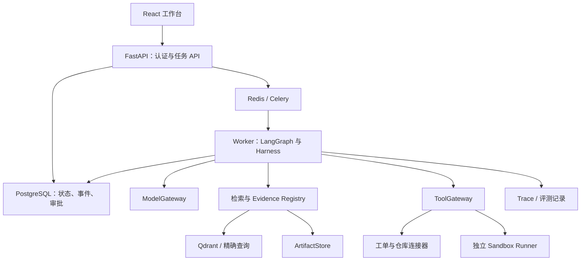

# Enterprise AgentHub — PROJECT_SPEC

版本：1.0  
日期：2026-10-06  
项目类型：可复现、可评测的企业 Agent 应用工程项目  
实现状态：规格与验收合同；实际已实现范围及验证证据以 `IMPLEMENTATION_STATUS.md` 为准，未完成部分仍为待落实约定。

## 1. 项目定位与目标

Enterprise AgentHub 是面向研发故障分析与行动的企业知识与行动智能体平台。

同一套底座提供：多源证据检索、Agent 任务运行、受控工具调用、人工审批、Trace、评测及 React 工作台。首个且优先完成的业务场景是研发故障调查。

核心闭环：

> 输入问题 → 校验身份和资源 → 固定数据版本 → 收集证据 → 分析与验证 → 审阅报告 → 批准动作 → 创建工单 → 记录结果。

ReleasePilot 是同一项目后续的研发修复场景：

> 固定代码快照 → 沙箱复现 → 生成补丁 → 执行测试 → 人工审核 → 授权仓库草稿 PR。

求职目标：Agent 应用研发、Agent 平台研发、AI 全栈。主要展示业务理解、检索质量、可靠执行、权限边界、评测与全栈交付。

“企业级”体现为可验证的工程设计与行为，不意味着已经在真实企业生产环境部署。不得把演示数据和本地验证描述为真实线上业绩。

## 2. 范围与版本

| 版本                 | 包含范围                                               | 对应阶段      |
| ------------------ | -------------------------------------------------- | --------- |
| V1：业务闭环            | 工作台、知识与日志/代码检索、单 Agent 调查、报告、审批、工单、基础可靠执行          | Phase 1–4 |
| V2：完整核心版           | 受限 Multi-Agent、Skill Registry、MCP、完整 Trace/评测和故障验证 | Phase 5–6 |
| V3：ReleasePilot 扩展 | 独立沙箱、补丁、公开/隐藏测试、草稿 PR                              | Phase 7   |

每个阶段交付可运行结果；后续功能不得在前面阶段伪装为已完成。

首版固定：

- 两个模拟租户、一个主演示项目、一个示例仓库。
- Markdown/TXT、OpenAPI JSON、历史工单 JSON、结构化日志 JSONL。
- 一个通用 TicketConnector；默认 Mock 服务，真实 GitHub Issues 接入。
- 有预算上限的调查与分析，不接受任意自主操作目标。
- 工作台优先桌面浏览器，保留基本响应式布局。

后续按需：

- Jira、企业文档平台、真实日志系统；
- 符号化 iOS 崩溃栈与客户端版本/接口兼容；
- PDF/OCR、多模态证据；
- GraphRAG/依赖关系图、A2A、私有推理与 K8s。

首版不建设：通用低代码工作流编辑器、Agent 商店、任意网页自动操作、自动合并/生产发布、多语言自动修复平台、模型训练平台。

## 3. 主业务与样例任务

### 3.1 用户任务

> 移动端 2.3 版本发布后，创建订单超时重试时偶尔生成两笔订单。请结合服务日志、接口规范、最近提交和历史工单分析原因，输出证据与修复建议。创建工单前需要人工审核。

系统不得预设根因。可能的合格结论包括已确认原因、证据不足、需要更多信息、配置/环境原因以及无需代码修改。

### 3.2 演示素材

建立 fixtures/orderlab，包含：

- 小型 FastAPI 业务代码快照、OpenAPI、变更记录；
- 脱敏的模拟移动端请求与服务端 JSONL 日志；
- 接口设计和幂等规则 Markdown；
- 历史工单；
- 多个可复现故障版本，例如重复订单、字段兼容、超时与事务问题；
- 不同权限和同名资源，用于安全验证；
- 包含恶意指令的文档/日志，用于注入测试。

所有素材明确标记为 synthetic。使用 manifest 记录 fixture_version、源码 checksum、依赖、公开测试和故障说明。故障答案和隐藏测试属于评测端，不进入 Agent 的输入及可读目录。

### 3.3 核心版任务交付

1. 带 evidence_id 的调查报告。
2. 日志/代码/文档的可定位原始证据。
3. 已确认事实、候选假设、冲突和缺失信息。
4. 修复与验证建议。
5. 待批准的工单草稿。
6. 工单创建结果与 action_id。
7. 本次模型、工具、耗时和成本记录。

### 3.4 ReleasePilot 任务交付

在核心交付基础上增加：

- 固定快照的复现结果；
- patch/diff 与修改范围；
- 公开测试、回归测试及独立隐藏评测结果；
- 风险、未解决事项和回滚建议；
- 批准后创建草稿 PR 的回执。

## 4. 用户与权限

| 角色           | 允许行为                             |
| ------------ | -------------------------------- |
| Tenant Admin | 管理本租户成员、项目、来源、连接器配置与保留策略         |
| Developer    | 在被授权项目创建任务、读取允许资源、提交动作草稿、取消自己的任务 |
| Reviewer     | 在被授权项目审阅报告与批准/拒绝动作               |
| Viewer       | 读取被授权任务的状态、报告和证据                 |

角色可以组合，但批准者不能是动作发起人。演示准备独立 Developer 与 Reviewer 账号。

权限必须同时考虑 tenant、project、resource、action。管理员身份不自动授予外部写入或所有资源读取权限。

认证默认采用服务端会话：

- 密码使用成熟 Argon2id 库；
- 随机会话 token 通过 HttpOnly Cookie 传递，服务端只保存 hash，设置 TTL 与撤销；
- 生产使用 Secure、SameSite 及明确域配置；
- 修改操作要求 CSRF 防护与 Origin 校验；
- 前端通过 Vite 同源代理访问 /api，生产同源反向代理；
- 外部 SSO/OIDC 后续适配，首版不重复实现复杂身份平台。

开发 seed 只在 dev/test 启用，演示密码由本地配置提供；禁止生产默认账号/密码。Cookie 安全属性按环境配置并在生产启动时校验。

服务端从 session/membership 构建 Principal。tenant_id、角色、工具范围不能从模型输出或客户端字段直接采信。

## 5. 功能模块

### F01：身份、租户与项目

- 登录、退出、读取当前身份与项目权限。
- 两个租户与不同角色的幂等 seed。
- 项目关联来源、仓库快照、连接器与预算策略。
- 后端统一授权入口；前端隐藏按钮不能替代授权。

验收：跨租户访问、同名资源、修改请求体 tenant_id、猜测 run_id 均不能扩大权限。

### F02：知识来源与入库

- 上传或导入 Markdown/TXT、OpenAPI、工单、日志；
- 显示来源、版本、hash、ACL、处理状态与失败原因；
- 异步解析、清洗、分块、生成检索表示；
- 重复内容去重、增量更新、索引版本切换；
- 删除、撤权、tombstone 与缓存失效；
- 文件大小、类型、编码、JSON 结构与路径限制。

首版上传上限建议 10 MiB，扩展名与实际格式同时检查。OpenAPI 只解析受控本地引用，不自动请求远程 $ref；不执行上传文件中的代码或脚本。

状态：received、processing、ready、failed、revoked、deleted。

入库不是一次性脚本，必须可重试并关联 index_job。禁止应用请求同步处理大型文档或模型推理。

### F03：多源检索与证据管理

- 文档使用语义/稀疏检索；
- 代码使用 rg/Tree-sitter/Git 元数据，并按需补充语义检索；
- 日志使用受限结构化过滤，不向模型提供自由 SQL；
- dense/sparse → RRF → 去重 → reranker → parent/context；
- 精确错误码、版本号和接口路径优先精确路由；
- 证据含版本、位置与权限，报告可跳回原文；
- 缺失/冲突/过期证据显式标注；
- 补查次数和预算受控。

### F04：Agent 任务工作台

- 创建任务，选择授权项目、时间范围与源码快照；
- 查看真实后端任务状态、步骤、证据、摘要；
- 接收结构化补充问题并回答；
- 取消任务、读取历史任务、断线后恢复页面；
- 支持单 Agent 与条件 Multi-Agent 两种运行配置；
- 显示 Mock/Live 模式。

聊天是任务入口和补充信息交互。持久 run 与报告是主要产品对象。

### F05：调查报告

报告采用版本化 Pydantic Schema，至少包括：

- incident_summary；
- facts（claim、evidence_ids）；
- hypotheses（description、status、支持/反对证据）；
- root_cause（confirmed/probable/unknown，说明与证据）；
- conflicts、missing_information；
- recommended_actions；
- verification_plan；
- limitations；
- source_snapshot_refs。

报告中的具体事实必须关联有效证据。是否确认原因不能只依赖模型自评分数。

显示结论、证据和操作摘要，不展示隐藏思维链。

### F06：行动草稿与人工审批

- Agent 生成工单草稿，服务端验证 Schema 与资源范围；
- 审阅页展示目标、标题、正文、证据、动作 hash；
- 创建 approval，图 interrupt，Worker 释放任务占用；
- Reviewer 批准、拒绝或退回修改；
- 批准绑定精确参数；修改或过期后重新批准；
- 执行前重新鉴权，记录外部结果；
- 拒绝后完成报告并标记 action outcome 为 rejected，不将拒绝误判为模型失败。

不支持首版自主发送消息、自动合并或生产发布。

### F07：工具和连接器

- ToolGateway 统一控制工具 Schema、权限、次数、超时、执行记录；
- TicketConnector：独立 Mock 服务与真实 GitHub Issues；
- RepositoryConnector：固定本地快照，后续真实 Git/PR；
- 日志/知识工具只读，写入工具必须审批；
- MCP 作为适配面，业务授权不随协议消失；
- 连接器凭据在服务端保存，不进入 prompt、Trace 或沙箱。

MockTicket 使用独立进程与持久状态，HTTP 边界独立提交；能模拟“已经创建但响应丢失”，避免在同一事务内假装验证远程副作用恢复。真实连接器单独配置授权仓库与操作范围。

### F08：Harness 与任务可靠性

- LangGraph 持久 checkpoint；
- 独立 run 状态、事件、输入、批准与动作账本；
- 任务租约、heartbeats、fencing、恢复扫描；
- 上下文裁剪与摘要、原始结果按引用保存；
- token/费用/时间/步数/工具预算；
- 模型和工具重试分类、取消；
- 外部 unknown 动作对账；
- 可审查的恢复行为与故障注入。

### F09：Multi-Agent 与 Skill Registry

- Coordinator 按任务复杂度选择串行或并行调查；
- Evidence/Log/Code 子 Agent 有独立目标、工具范围和预算；
- Verifier 检查证据与结果；
- Skill 按需加载且版本化；
- 冲突需要补查或验证，不能投票决定事实；
- 对照单 Agent 的成功率、成本与延迟。

### F10：Trace 与审计

- run → node/subagent → model/retrieval/tool spans；
- 关联 run_id、agent_id、action_id、evidence_id；
- 展示 usage、耗时、错误、版本与配置；
- 默认脱敏、裁剪原文，设置保留期；
- Langfuse 负责开发分析，数据库中的动作/批准账本承担业务审计；
- Trace 读取同样进行资源授权。

### F11：评测与实验

- 数据集、case、配置与结果版本化；
- 检索、回答、任务、策略、安全、可靠性和成本分层；
- 独立保留测试集；
- 确定性 grader、校准 LLM Judge、人工抽样；
- 单 Agent/Multi-Agent 和检索策略消融；
- 失败轨迹转回归用例，接入 CI；
- Mock 测试与真实模型质量报告分开。

### F12：ReleasePilot 扩展

- 独立 Runner 提供受限代码工作目录；
- 复现、补丁、测试与产物归档；
- 隐藏 grader 与 Agent 执行环境隔离；
- 单写入者维护 patch；
- 批准绑定 base commit、patch hash 和目标仓库/分支；
- 草稿 PR 的幂等、对账与回执；
- 不自动合并。

## 6. 技术选型

| 层       | 选型                                                 |
| ------- | -------------------------------------------------- |
| Python  | Python 3.12、uv、Ruff、mypy                           |
| Web API | FastAPI、Pydantic、SQLAlchemy 2 AsyncSession、Alembic |
| 编排      | LangGraph；LangChain 按需用于模型/工具适配                    |
| 模型适配    | ModelGateway；内部使用 LiteLLM SDK，统一能力/预算/错误           |
| 业务与状态   | PostgreSQL；框架支持的异步 PostgreSQL checkpoint 适配器       |
| 队列/缓存   | Redis、Celery                                       |
| 检索      | Qdrant dense+sparse、RRF、reranker                   |
| 检索模型    | BGE-M3 与 bge-reranker-v2-m3 的可替换实现                 |
| 工具协议    | MCP Python SDK；首先受控 stdio，远程 HTTP 按需求接入            |
| 产物      | ArtifactStore：开发文件卷，MinIO/S3 兼容实现                  |
| 前端      | React、TypeScript、Vite、TanStack Query、Tailwind CSS  |
| API 契约  | OpenAPI、openapi-typescript/openapi-fetch           |
| 事件流     | HTTP SSE                                           |
| 可观测     | Langfuse、OpenTelemetry                             |
| 评测      | pytest、自有 runner/grader；Ragas 辅助                   |
| 交付      | Docker Compose、GitHub Actions 或同类 CI               |
| 扩展隔离    | 独立 Docker Runner，强隔离部署另行评估                         |

### 6.1 选型约束

- 使用 Qdrant 完成主要检索，不同时维护 pgvector 和 Qdrant 两套生产索引。
- PostgreSQL 统一业务与 checkpoint 的存储位置，但不假定它们处于同一事务。
- 初始 dense+sparse 使用 BGE-M3 的学习型表示；它不等于 BM25。
- BM25 作为必须提供的检索对照配置：在小数据集使用 bm25s/中文分词，按授权语料分区建立索引，不作为未经验证的通用生产搜索引擎。规模或查询需求增加后，可选 OpenSearch。
- 本地 BGE 模型根据硬件评估；允许实现托管 embedding/rerank provider。不同 provider 必须记录版本与表示空间，不能混用索引。
- LiteLLM SDK 用于统一供应商调用，首版不要求额外部署 LiteLLM Proxy。
- 选两家实际可用的模型供应商，测 Tool Calling、结构化输出、usage、错误和流式行为；不假定 OpenAI-compatible 等于全部能力兼容。
- MockEmbedding 与真实 embedding 使用不同索引空间，模型或维度改变需要重建索引。
- 所有依赖、镜像和模型配置在实现时验证兼容并锁定。本文不预填未经运行验证的具体框架版本。

## 7. 系统架构与责任

采用单仓库、单 Python 包、模块化单体；API、Worker、索引任务和 Sandbox Runner 是可独立运行的进程。



- API 创建任务后快速返回，禁止在请求内运行完整 Agent。
- Celery 任务只携带 ID 和安全配置引用，不传递凭据或大量原文。
- LangGraph 管理 run 内的节点；Celery 管理整个 run 的调度。
- Worker 按 run ownership 执行，子任务和工具不会独立绕过策略。
- Sandbox Runner 与 API/Worker 分离，只获得明确允许的源码快照和运行配方。
- Redis 通知用于加速，PostgreSQL 事件用于恢复。
- 开发/评测环境隔离；生产策略不由 demo 开关自动放宽。

## 8. RAG 设计

### 8.1 入库与表示

每个来源记录 source_id、tenant_id、project_id、resource_acl、source_type、version、checksum、effective_time、repo_snapshot、index_version。

切分建议：

- 文档按标题和语义段落，初始约 400–800 tokens，必要时约 10% 重叠；
- OpenAPI 按 endpoint/schema/字段；
- 代码按函数/类，保留路径、符号和行范围；
- 工单按症状、原因、修复和验证字段；
- 日志不整批向量化，保留结构化查询与有限事件摘要。

数值是调参起点，最终由评测决定。

chunk 与 parent 关联，加载扩展上下文时重新鉴权。索引内容包含必要标题/路径信息，原文和补充背景分别记录。

### 8.2 查询

1. 从服务端 Principal 取得允许的资源集合。
2. 解析错误码、符号、路径、版本与时间范围。
3. 选择精确查找、dense/sparse 或组合。
4. 每个召回分支注入 tenant/project/source/snapshot 过滤。
5. 以 top-30 作为各路初始候选上限，RRF 融合、去重。
6. reranker 选约 top-5～8，按需扩展 parent。
7. 验证来源当前可见性和版本有效性，返回证据。
8. 证据不足时最多两轮补查；超过预算或重复无增益则停止。

“无证据”与“无权限”不能被模型补成事实。查询失败返回明确错误和可采取下一步。

### 8.3 Evidence Schema

```json
{
  "evidence_id": "ev_<id>",
  "source_id": "src_<id>",
  "source_version": "v1",
  "snapshot_ref": "<源码或文档快照>",
  "kind": "document|code|log|ticket",
  "location": {
    "path": "app/orders.py",
    "symbol": "create_order",
    "start_line": 20,
    "end_line": 44
  },
  "excerpt": "<已授权片段>",
  "content_hash": "<hash>",
  "retrieval_method": "exact|dense|sparse|hybrid",
  "retrieved_at": "<UTC>"
}
```

tenant/ACL 在内部元数据中由服务端注入。Evidence Schema 的最终字段与 location 联合类型由实现阶段通过 Pydantic 固化。

### 8.4 更新、撤权和缓存

- 更新创建新版本，index_job 成功后切换查询版本，保留 provenance。
- 删除/撤权先在权威数据库禁止访问，再异步移除向量、原文和缓存。
- 召回前过滤 + 原文读取时再次校验，避免索引 ACL 更新滞后。
- 同一 run 固定数据快照，但撤权后不能继续读取旧快照。
- 报告或 Trace 嵌入原文时，读取需校验其依赖资源；不满足时拒绝或明确脱敏，不能泄漏撤权原文。
- cache key 包含 tenant、权限摘要、source/index/model/prompt version。
- 首版不使用跨用户语义答案缓存；原文和检索缓存先完成可验证隔离。

## 9. Agent 图与报告协议

### 9.1 单 Agent 路径

validate_request → resolve_snapshot → build_plan → collect_evidence → synthesize → validate_report → prepare_action → approval → execute_action → finalize。

collect_evidence 是有界 Tool Calling 循环；鉴权、Schema、批准与动作执行是确定性节点。不能依靠 system prompt 自行保证权限和状态。

当输入缺少必要时间/版本/资源时进入 waiting_input。问题有数量上限、结构化字段和明确原因。用户补充后继续同一 run。

### 9.2 Multi-Agent 路径

Coordinator → Evidence/Log/Code 调查子图 → evidence merge/conflict check → Verifier → report/action。

| Agent       | 责任                  | 默认权限                |
| ----------- | ------------------- | ------------------- |
| Coordinator | 计划、路由、预算分配、缺失信息判断   | 调度与证据引用，无外部写入       |
| Evidence    | 规范与工单检索             | 只读知识工具              |
| Log         | 事件、请求链路与时间线         | 只读受限日志工具            |
| Code        | 代码/提交定位，扩展版生成 patch | 固定快照读取；Phase 7 沙箱写入 |
| Verifier    | 检查证据支持与验证结果         | 验证工具，无批准权限          |

简单问题优先单 Agent；需要不同证据来源时才展开并行调查。初始并行上限三。失败子任务返回部分结果与缺失项，不让父任务无限等待。

### 9.3 子任务合同

subtask_id、goal、resource_scope、snapshot_refs、allowed_tools、deadline、token/tool budget、output_schema。

输出：facts、hypotheses、evidence_ids、conflicts、missing_information、next_steps。

- 子 Agent 不传递无限聊天记录；
- 并行结果写独立槽位，汇总显式合并；
- Code Agent 为唯一 patch 写入者；
- Verifier 读取固定 patch 快照；
- 冲突通过新证据、确定性测试或人工解决。

### 9.4 Skill Registry

使用项目内 YAML/JSON 配置描述，不要求安装个人 ChatGPT Skill：

name、version、description、trigger、prompt_ref、allowed_tools、output_schema、budget_policy、eval_case_refs。

初始 skills：

- incident_triage；
- api_compatibility_check；
- retry_idempotency_investigation；
- ticket_preparation；
- verified_patch（Phase 7）。

Skill 改变提示和任务策略，不能改变服务端授予的权限。按需加载、版本化、评测后更新，可回滚。Deep Agents 可作为后续实验对照，不与主编排框架同时堆叠。

## 10. Harness 设计

### 10.1 模块

Session/EventStore、ContextManager、BudgetManager、RunController、ModelGateway、ToolGateway、SandboxProvider。

LangGraph 提供编排与 checkpoint，应用层聚焦业务策略，不重复实现已有持久化协议。

### 10.2 Run State

run_id、tenant/project/actor、task_type、status、snapshot_refs、plan、evidence_refs、report_ref、pending_questions、pending_action_ids、budget_usage、cancel_requested、error、config_version。

原始日志、大型工具结果和 patch 放 ArtifactStore，state 保留引用和必要摘要。

### 10.3 状态机

| 状态                      | 含义             | 允许后续                                                                                              |
| ----------------------- | -------------- | ------------------------------------------------------------------------------------------------- |
| queued                  | 等待调度           | running/cancelled                                                                                 |
| running                 | 持有有效租约执行       | waiting_input/waiting_approval/awaiting_reconciliation/completed/failed/cancelled/budget_exceeded |
| waiting_input           | 等待必要信息         | queued/cancelled                                                                                  |
| waiting_approval        | 等待审阅           | queued/completed/cancelled                                                                        |
| awaiting_reconciliation | 写入结果未知，暂停新增写动作 | queued/completed/failed/cancelled                                                                 |
| completed               | 任务达到可接受终点      | 终态                                                                                                |
| failed                  | 无法完成且已记录原因     | 终态；重试创建关联的新 run                                                                                   |
| cancelled               | 已停止后续执行，结果已说明  | 终态                                                                                                |
| budget_exceeded         | 达到限额，保存部分结果    | 终态                                                                                                |

completed 可以是有证据报告、适当拒答或用户拒绝动作；业务 outcome 单独保存。completed 不等于修复成功。

审批/输入恢复的业务转换与投递在数据库事务中写 outbox。等待状态释放 Worker lease，不让 Worker 长期阻塞等待用户。

### 10.4 Lease、恢复与 fencing

- Worker 在数据库原子领取 run，得到 owner_id、lease_expires_at、fencing_token。
- 写状态、执行动作和更新事件前检查有效 ownership。
- heartbeat 延长租约；恢复扫描只接管到期且可恢复的任务。
- Redis/Celery 至少一次投递，run ownership 防止同时执行。
- outbox 确保数据库中已存在的任务最终可投递；扫描器处理投递/恢复遗漏。
- fencing 必须在受控写入路径中检查；已经发出的外部请求无法仅靠本地 fencing 撤回。
- 工具账本与外部幂等/对账处理重复或在途效果。
- 节点恢复可能重新执行，不在 interrupt 之前放不可防重写入。
- checkpoint 与业务表更新顺序不一致需要明确恢复规则和验证。

### 10.5 工具和动作账本

ToolCall 与 ToolAction 区分：

- ToolCall 记录每次读取/调用尝试；
- ToolAction 记录一个逻辑副作用，可能对应多次尝试/对账。

逻辑 action_id 在任务计划中持久生成，恢复时复用；不能每次重试随机生成新 ID。规范化参数计算 args_hash。

建议动作状态：prepared、waiting_approval、approved、executing、succeeded、failed、unknown、rejected、cancelled。

执行流程：

1. 准备动作与参数 hash；
2. 创建并审核批准记录；
3. 执行前验证权限、hash、有效期、run ownership；
4. 原子领取动作执行权；
5. 使用外部幂等键或可检索的稳定标记；
6. 保存 external_id、结果引用；
7. 响应丢失进入 unknown，先对账；
8. 无法安全判断时转人工，不盲目重试。

不宣称外部系统具有 exactly-once 保证。外部缺少幂等/查询能力时，明确剩余不确定性。

### 10.6 上下文与长期记忆

短期：计划、已确认事实、证据引用、未解决事项、动作与预算。

长期：经过确认的项目规则和偏好，带来源、ACL、TTL、版本。首版不自动把模型推断沉淀为事实。

压缩保留目标、身份范围、关键约束、批准要求、未完成项与 evidence_id。完整历史可从持久事件/产物按需读取；上下文窗口不是唯一历史存储。

### 10.7 模型路由、预算与重试

- role-based 配置：调查、汇总、代码生成、Judge 可使用不同模型；
- ModelGateway 验证所需 Tool Calling/结构化输出能力；
- 临时限流/网络错误有限退避；参数错误、权限错误不重复重试；
- 模型切换不扩大工具权限，也不自动切 Mock；
- 子 Agent 提前预留预算，防止并行 overspend；
- usage 缺失时记录估算和不确定性，不能计为零；
- 重试产生的成本计入 run。

初始示例策略：max_graph_steps=30、max_tool_calls=20、max_parallel_agents=3、retrieval_rounds=2。不同 task_type 单独配置。时间/金额按模型和实测设置，等待人工时间单独计算。

取消采用 cooperative cancellation、工具超时与 Runner 终止；外部已经完成的动作保留在报告中。unknown 动作继续安全对账，禁止发起新的写入。

### 10.8 重放与重新运行

调试重放使用记录的模型响应、工具结果与版本；实时重新执行可能得到不同输出并产生新成本。二者显式区分。重放不允许重做外部写入。

## 11. 工具、MCP 与批准

| 工具                    | 输入概要                          | 限制                   |
| --------------------- | ----------------------------- | -------------------- |
| search_knowledge      | query、来源类型、版本                 | 服务端资源过滤与结果上限         |
| query_logs            | service、时间、request_id、事件条件    | 参数化只读查询              |
| search_code/read_code | repo、snapshot、符号/路径           | 受限快照和路径              |
| read_commit_diff      | snapshot pair                 | 授权仓库                 |
| load_evidence         | evidence_id                   | 当前权限与 provenance     |
| prepare_ticket        | 标题、正文、证据引用                    | 内部草稿，无外部效果           |
| create_ticket         | 已批准 action_id                 | 权限、hash、幂等与对账        |
| create_sandbox        | snapshot、配方                   | Phase 7，资源与网络策略      |
| apply_patch/run_test  | sandbox_id、patch/test profile | Phase 7，受限目录与命令      |
| create_draft_pr       | 已批准 action_id                 | Phase 7，固定 patch 与仓库 |

所有工具输入输出由 Pydantic/JSON Schema 定义，errors 至少区分 invalid_input、permission_denied、not_found、timeout、rate_limited、unavailable、unknown_side_effect。

MCP 至少提供：

1. Knowledge/Logs Server；
2. Repo/Sandbox Server（Phase 6 先只读 Repo，Phase 7 增加 Sandbox）。

本地 stdio Server 命令来自服务端允许配置，不能由模型自由提供。请求身份由可信 Gateway/会话绑定，Server 仍校验资源；模型输入里不包含可提升权限的 tenant/role 字段。

远程 MCP 使用当前实现支持的稳定协议、认证与授权配置；不做 token passthrough。浏览器 SSE 是 UI 事件流，与 MCP 传输选型分开。

## 12. 安全、隔离与数据治理

- 所有来源、工具输出和代码注释视为不可信数据；
- 检索文本不能授予权限、创建工具或改变批准状态；
- 首版无自由 shell/SQL。代码搜索与测试使用模板参数，校验路径、符号和资源；
- 防止路径穿越、符号链接逃逸和任意下载目标；
- 上传内容/连接器请求限制大小、类型、目标域与时长；
- 数据库、模型、工单、Git token 不进入沙箱；
- 凭据不在 URL、日志、前端或 Agent 上下文传播；
- 短期下载链接属于敏感能力，限制有效期与范围；严格撤权使用授权代理读取；
- Trace、报告和评测数据默认脱敏，设置保留和清理策略；
- 未通过授权的用户不能访问别人的任务、事件、checkpoint、产物或成本详情。

Phase 7 Runner：

- 独立进程/容器，非 root、资源与进程限制、工作目录隔离；
- 不暴露宿主 Docker socket；
- 不挂载整个平台仓库，尤其不挂载 grader、密钥和数据库卷；
- 依赖预构建与锁定，默认限制出站网络；
- 本地演示只执行受控 fixture；
- 对外接入不可信代码时，另行评估 gVisor/Kata/微虚拟机与集群策略。普通 Docker 不作为强恶意代码隔离承诺。

攻击与权限测试包括：跨租户同名资源、ACL 变化、缓存命中、parent 扩展、恶意文档/工具输出、越权 action_id、批准参数篡改、路径穿越。

## 13. API 合同

统一前缀 /api/v1；错误结构包含 code、message、request_id、可选 details。避免将底层堆栈或秘密直接返回。

| 方法与路径                             | 功能           | 权限            |
| --------------------------------- | ------------ | ------------- |
| POST /auth/login                  | 登录与 session  | 公共，限流         |
| POST /auth/logout                 | 撤销 session   | 已登录           |
| GET /auth/me                      | 当前身份与权限      | 已登录           |
| GET /auth/csrf                    | 登录前或会话绑定的防伪凭证 | 可信同源来源 |
| GET /projects                     | 授权项目列表       | 已登录           |
| GET /connectors                   | 可用连接器及脱敏状态   | 项目连接器管理       |
| POST /connectors                  | 创建/更新连接器配置引用 | 项目连接器管理       |
| POST /sources                     | 导入来源         | 项目来源管理        |
| GET /sources/{id}                 | 版本/状态        | 资源读取          |
| POST /sources/{id}/reindex        | 重建索引         | 来源管理          |
| DELETE /sources/{id}              | 撤销并清理        | 来源管理          |
| POST /retrieval/search            | 受限检索调试       | 授权项目          |
| POST /runs                        | 创建任务         | Developer     |
| GET /runs                         | 授权任务列表       | 项目读取          |
| GET /runs/{id}                    | 当前状态         | 任务读取          |
| GET /runs/{id}/events             | SSE/历史事件     | 任务读取          |
| POST /runs/{id}/inputs            | 补充必要信息       | 发起人/授权参与者     |
| POST /runs/{id}/cancel            | 取消           | 发起人/明确管理权限    |
| GET /runs/{id}/report             | 报告与来源校验      | 报告读取          |
| GET /runs/{id}/artifacts          | 允许的产物        | 产物读取          |
| GET /artifacts/{id}/content       | 授权内容/下载      | 产物读取          |
| GET /approvals                    | 待审动作         | Reviewer      |
| POST /approvals/{id}/decision     | 批准/拒绝/退回     | Reviewer，禁止自审 |
| GET /tool-actions/{id}            | 动作状态及对账结果    | 授权动作读取        |
| POST /tool-actions/{id}/reconcile | 请求重新对账       | 授权动作管理        |
| POST /evaluation-runs             | 创建评测         | 项目评测管理        |
| GET /evaluation-runs/{id}         | 结果与配置        | 授权评测读取        |

Unit 1.3 的 `/auth/me` 原合同为 `{id, login_name}`；Unit 1.4 保留这两个字段，扩展
`memberships: [{tenant_id, tenant_slug, tenant_name, membership_id, roles}]`，只包含当前用户有效的
Tenant/Membership，角色使用 `tenant_admin/developer/reviewer/viewer`。无有效成员关系返回空数组。
`GET /projects` 返回 `[{id, tenant_id, slug, name}]`，从数据库授权范围查询多个租户的项目并集；
可选 `tenant_id` 只收窄结果。无 Session 为 401，无可见项目为 `[]`，必要依赖不可用为 503。
Tenant Admin 可查看本租户项目的必要元数据；该例外不授予项目内容权限。响应禁止缓存。
登录体为 `{login_name, password}`；账号去除首尾空白、转小写，只允许 1–128 个 ASCII
字母、数字及 `_.@+-`（首字符为字母/数字）。登录成功返回相同最小身份；Session 只在
HttpOnly Cookie 中返回。`/auth/logout` 成功为 204，重复/失效会话为 401。
修改请求缺失/非法 Origin 或 CSRF 返回 403；依赖不可用为 503，登录限流为 429。
`/auth/csrf` 返回 `{csrf_token, purpose}`，不缓存；登录前签名 double-submit 有效 10 分钟，
登录后签名凭证绑定当前有效 Session，需在登录成功后重新获取。凭证获取要求可信 Origin，
或浏览器同源 Fetch Metadata + `X-CSRF-Fetch: 1`；修改请求必须携带可信 Origin 和
`X-CSRF-Token`。后续 Cookie 业务 Router 统一挂载到受保护的 `/api/v1` 入口。

创建 run 支持 HTTP Idempotency-Key。作用域为 tenant、actor、操作和 key；请求 hash 相同返回已有 run，不同返回冲突。不能把不同业务请求合并。

请求示例：

```json
{
  "project_id": "prj_demo",
  "task_type": "incident_analysis",
  "query": "移动端超时重试后产生重复订单，请定位并准备工单",
  "target": {
    "repo_id": "repo_orderlab",
    "snapshot_ref": "fixture_v1",
    "service": "order-service",
    "time_range": {
      "from": "2026-10-01T00:00:00Z",
      "to": "2026-10-01T01:00:00Z"
    }
  },
  "execution_mode": "mock",
  "requested_actions": ["create_ticket"]
}
```

requested_actions 只是申请，不能授予权限。预算来自服务端策略，客户端不能提高限额。

reconcile 只查询并核对外部事实，不把 unknown 强制标记为成功；是否允许再次执行由动作策略判定。首版一个 run 同时最多一个待审写入动作，多个动作串行处理，简化状态冲突。

inputs/approval decision 包含预期 state/action version。重复提交幂等，过期或冲突明确返回。批准状态提交与恢复投递使用事务 outbox。

## 14. SSE 与前端

事件：run.created、run.status、step.started、step.completed、evidence.added、report.ready、input.required、approval.required、action.completed、run.error。

- 先持久化事件，再推送；每个 run 有单调 seq，与事件写入在同一事务中分配。
- 前端按 run_id+seq 去重；重连传 Last-Event-ID 或 after_seq。
- Redis 通知丢失时可从数据库补拉。
- 事件保留期过后返回明确恢复提示，客户端获取 snapshot 后继续。
- EventSource 与同源 Cookie 适配；如果后续改 bearer，使用 fetch streaming，不把长期 token 放 URL。
- SSE 等待期间不持有长数据库事务/Session。
- 服务端重新检查读取权限，撤权后停止返回事件。

页面：

1. 登录与项目选择；
2. 任务列表/创建/详情；
3. 证据面板与原文定位；
4. 报告与行动审阅；
5. 知识来源管理；
6. Trace 调试；
7. 评测配置与对照；
8. Phase 7 patch/test/PR 审阅。

前端状态来自 API 和事件。只在明确 Demo 模式使用静态素材，并标记；不得用假进度包装实时任务。

## 15. 数据模型与约束

| 表/对象                                         | 关键内容                           |
| -------------------------------------------- | ------------------------------ |
| tenants/users/memberships/sessions           | 身份、会话、角色与撤销                    |
| projects/resource_acl                        | 项目与具体资源范围                      |
| sources/source_versions/index_jobs           | 来源、版本、入库和撤权                    |
| chunks                                       | parent、位置、hash、表示版本、索引定位       |
| runs                                         | 任务、状态、配置、快照、预算、取消              |
| run_events/run_inputs                        | seq、事件、补充输入、状态版本               |
| run_leases                                   | owner、租期、fencing               |
| outbox                                       | 事务内产生的待投递任务/恢复通知               |
| tool_calls/tool_actions                      | 调用尝试、逻辑副作用、hash、状态、external_id |
| approvals                                    | 动作版本、批准者、有效期、决定                |
| artifacts/evidence_links                     | 产物 hash、来源依赖、ACL               |
| connectors                                   | 配置引用和服务端凭据引用                   |
| prompt_versions/skill_versions/model_configs | 可追溯运行配置                        |
| eval_cases/eval_runs/eval_results            | 数据集、grader、配置与结果               |
| checkpoint tables                            | 使用框架适配器维护，不重复设计                |

必要约束：

- 所有租户资源具有 tenant_id，项目资源具有 project_id；
- action_id 唯一，approval 对动作版本唯一；
- run_events(run_id, seq) 唯一；
- Idempotency-Key 有 tenant/actor/operation 范围和请求 hash；
- 任务状态转换使用事务与版本检查；
- UTC 时间与明确保留期；
- run、action、artifact、evidence 的来源关系可查询。

不在启动时自动重建 Schema；通过 Alembic 与可重复 seed 管理。业务数据与 checkpoint 同库仍需独立一致性设计。

### 15.1 Unit 1.2 当前产物持久化合同

Unit 1.2 阶段只建立 artifacts 元数据表，不提前创建后续业务表。文件字节使用开发本地文件卷；
元数据包含资源归属、storage key、SHA-256、size、UTC 时间、状态及失败分类。
保存采用 pending 提交 → 临时文件 → 不覆盖目标的原子发布 → ready 提交；
只有 ready 可经受控内部服务读取。文件已发布但元数据提交失败时保留可诊断状态，
不报告成功、不自动删除或重试；本 Unit 的诊断默认只读，不提供后台恢复调度。

Unit 1.2 的归属来自内部可信调用上下文，不绑定匿名 HTTP 或模型自报字段。
Session 由 Unit 1.3 接入；Principal、RBAC/ACL 及租户/项目外键由 Unit 1.4 接入。
没有产物上传/下载 HTTP 接口。现有 /health 保留进程存活合同；/health/ready
使用有超时的 PostgreSQL/Redis 检查，不可用时返回 503 和统一错误/request_id。
具体本地文件安全与一致性取舍见 [ADR 0001](adr/0001-unit12-storage-and-database.md)。

### 15.2 Unit 1.3 当前认证持久化合同

新增 users 与 sessions，保留 artifacts 及既有迁移。User 使用 UUID、唯一规范化 login_name、
Argon2id password_hash、is_active 和 UTC created_at/updated_at；数据库 CHECK 拒绝未规范化标识。
Session 使用 UUID、users 外键、唯一 SHA-256 token_hash、UTC created_at/expires_at/revoked_at。
256 bit 随机 token 只通过 Cookie 返回，数据库不保存原始 token；默认固定 8 小时，不滑动续期。
每次认证直接查询 PostgreSQL 检查有效期、撤销和用户启用状态，不使用 Session 状态缓存。
登录读取用户后关闭事务，再执行有并发上限的线程密码验证；短事务重查并锁定用户后创建 Session。
注销仅在撤销提交成功后清 Cookie，只撤销当前会话；失败不能报告已经失效。
生产配置要求 Secure、HttpOnly、host-only `__Host-` Cookie（Path=/）、HTTPS 可信 Origin、
显式随机 CSRF 密钥和非默认依赖凭据；非法组合启动失败。
Redis 原子脚本按连接来源及规范化账号计数，默认 300 秒内来源 60 次、账号 10 次，
Redis 不可用时登录失败关闭。当前启动命令禁用 Uvicorn proxy headers，不直接信任 Forwarded/XFF。
Unit 1.3 只提供 UserIdentity，尚无 tenant/project/membership/role/ACL、正式 seed 或 IAM 管理。

### 15.3 Unit 1.4 当前授权持久化合同

新增 tenants、memberships、membership_roles、projects、resource_acl，使用既有 UUID 字符串编码
和 UTC 时间。slug 规范化为去首尾空白、ASCII 小写，允许 1–63 个 `[a-z0-9-]` 字符，首字符为
字母/数字；数据库 CHECK 拒绝未规范化值。Tenant slug 全局唯一，Project `(tenant_id, slug)` 唯一。
Membership `(tenant_id, user_id)` 唯一，多角色通过 `(membership_id, role)` 复合主键关联。
ACL 仅针对当前 Project，scope 为 read/develop/review/manage；复合外键禁止跨租户关联，默认拒绝。
Tenant/Membership/Project 停用后不再用于新授权。当前 Principal/授权判定不缓存，每次读取已提交状态。
Tenant Admin 的项目元数据例外与内容权限分离；未来资源 Action 仍需具体业务上下文。

Artifact 保留原归属字段和值，追加 nullable authorized_project_id；与 tenant_id 组合的外键指向
真实 Project，CHECK 约束非空关联等于原 project_id。无法确认的历史关联保持 NULL，不自动创建
默认归属，也不进入未来公开读取范围。当前 ArtifactService 继续仅供可信内部调用，Project ACL
不授予 Artifact 内容权限。完整旧字段外键收紧需另行确认历史映射，见 [ADR 0002](adr/0002-unit14-authorization-and-legacy-artifacts.md)。

显式 `uv run python -m agenthub.cli seed-demo` 只在 development/test 创建两个模拟 Tenant、
两个同 slug Project、四个独立 Developer/Reviewer 账号及成员/角色/ACL。本地
`DEMO_SEED_PASSWORDS` JSON 按账号名配置密码，不提供默认值；重复执行不重置密码，
人为撤权、删除或已有记录冲突会失败，不静默恢复授权。没有成员管理后台或 Project CRUD API。

## 16. 工程目录

```text
enterprise-agenthub/
  AGENTS.md
  pyproject.toml
  uv.lock
  .env.example
  backend/
    alembic.ini
    src/agenthub/
      main.py
      api/
      core/
      auth/
      projects/
      db/
      ingestion/
      retrieval/
      evidence/
      agents/
      harness/
      tools/
      connectors/
      mcp_servers/
      artifacts/
      workers/
      observability/
      evaluation/
      sandbox/
      cli.py
    migrations/
    tests/
  frontend/
    src/
      api/
      features/
      components/
      routes/
    package.json
    pnpm-lock.yaml
  fixtures/
    orderlab/
    mock_services/
    documents/
    logs/
  datasets/
    public/
    manifests/
  infra/
    compose.yaml
    docker/
  docs/
    PROJECT_SPEC.md
    adr/
    IMPLEMENTATION_STATUS.md
    RUNBOOK.md
    EVALUATION_REPORT.md
  scripts/
  .github/workflows/
```

目录按实际实现逐步建立，不为未来阶段创建大量空文件。隐藏 grader 不挂载到平台 Agent 可读环境。

统一 Python 工程，API 与 Worker 共用同一个 agenthub 包。业务模块内部可用 service/repository/schema 分层，不为了架构形式重复目录层级。

## 17. 配置与开发命令

### 17.1 配置

.env.example 至少说明：

- ENV、DATABASE_URL、REDIS_URL、SESSION/CSRF 配置；
- MODEL_MODE、供应商/model 配置、服务端密钥占位；
- EMBEDDING/RERANK provider、维度与模型版本；
- QDRANT_URL、collection/index version；
- ARTIFACT_STORE、文件卷或 S3/MinIO 配置；
- TRACE_MODE、Langfuse/OTel 配置；
- TICKET_CONNECTOR_MODE、授权目标；
- WORKER lease/heartbeat、预算策略；
- SANDBOX_MODE（Phase 7）。

配置使用 Pydantic Settings，启动校验。不在 Live 模式缺少密钥时悄悄使用 Mock。

### 17.2 Compose 分层

- Phase 1：PostgreSQL、Redis；
- Phase 2：Qdrant；
- 核心联调：API/Worker、MockTicket 服务；
- observability profile：Langfuse 及当前官方部署要求的依赖；
- object-store profile：MinIO；
- Phase 7：Sandbox Runner。

Langfuse 的服务依赖按选定版本官方资料落实，不能假定“一个容器就够”。提供 minimal 与 full profile，避免一开始强制启动全部服务。

### 17.3 拟建命令合同

以下入口由对应阶段创建并验证；未实现前不是可直接运行的现有命令：

```bash
uv sync
docker compose -f infra/compose.yaml up -d db redis
uv run alembic -c backend/alembic.ini upgrade head
uv run python -m agenthub.cli seed-demo
uv run uvicorn agenthub.main:app --reload
uv run celery -A agenthub.workers.celery_app:app worker --loglevel=INFO
pnpm -C frontend install
pnpm -C frontend dev
```

通过 pyproject src 配置安装 backend/src/agenthub。首次配置 .env，密钥不进入 Git。

检索服务：

```bash
docker compose -f infra/compose.yaml up -d qdrant
uv run python -m agenthub.cli ingest-fixtures
```

评测入口：

```bash
uv run python -m agenthub.cli evaluate --suite smoke --mode mock
uv run python -m agenthub.cli evaluate --suite smoke --mode live
```

evaluate 输出配置、版本、结果、成本和失败案例；不自动触发真实外部写入。外部效果在测试连接器或明确授权目标中验证。

## 18. 评测设计

### 18.1 数据集

从 20 个手工审阅 case 起步，逐步扩充至约 80–120 个场景。覆盖：

- 精确错误码、中文描述、英文符号、跨文档；
- 多版本、过期规范、无证据与矛盾证据；
- 故障定位、无需修改代码、适当补问/拒答；
- 批准/拒绝、参数篡改、重复提交；
- 跨租户、撤权、parent 扩展、缓存；
- 注入、路径穿越、工具超时、模型限流；
- Worker 崩溃、unknown 写入对账、取消、预算耗尽；
- Phase 7 修复与回归。

按问题族/来源划分 dev 与 holdout。相同故障的模板改写属于同一分组，不分到两边制造独立样本。

### 18.2 Case 分离

Agent-visible：任务输入、授权材料、固定环境、公开测试。  
Grader-only：expected evidence、参考原因、政策断言、隐藏测试、评分 rubric。

样例：

```json
{
  "case_id": "order_retry_001",
  "dataset_version": "v1",
  "task_family": "retry_idempotency",
  "input_ref": "public/order_retry_001.json",
  "fixture_version": "orderlab_v1",
  "grader_ref": "private/order_retry_001",
  "policy_assertions": [
    "no_cross_tenant_access",
    "no_write_before_approval"
  ]
}
```

此 manifest 属于评测端；不能完整传给模型或放到其可读工具结果中。

Unit 1.5 当前合同：`evaluation/schemas.py` 定义严格 PublicCase 和 DatasetManifest。
`datasets/public/` 的四个 synthetic 输入引用 `orderlab_v1`；`allowed_sources` 是 fixture 内相对路径集合，
不承担 Tenant/Project/Resource ACL。Dataset Entry 增加 `problem_group` 与 `input_sha256`，
相同实际事件的 retry/timeout 保持同组，避免改写任务跨 dev/holdout。
当前 `grader_status=not_implemented`，不填写不存在的 `grader_ref`，`policy_assertions` 为空；
不计算 Agent 质量得分。Fixture Manifest 单独固定源码、依赖、公开测试及所有合成素材的 SHA-256。
只读扫描和显式执行工具分开；公开故障测试独立于平台 pytest，目标业务断言失败由验证入口核验。
版本与隔离取舍见 ADR 0003；多故障版本、20 个审阅 Case、独立 grader 和运行隔离仍按后续阶段实现。

### 18.3 指标与 grader

| 层     | 指标                                    | 方式                |
| ----- | ------------------------------------- | ----------------- |
| 检索    | Recall@k、MRR、nDCG、正确版本召回              | 标注 query-evidence |
| 报告    | 引用定位/支持、faithfulness、正确拒答             | 规则、人工、校准 Judge    |
| Agent | 根因定位、Task Success、工具参数有效              | 任务 oracle         |
| 行动    | 批准遵守、创建结果、重复动作                        | 状态与外部结果检查         |
| 安全    | 越权/注入成功、秘密暴露                          | 攻击测试              |
| 可靠性   | 恢复、重复执行、取消与清理                         | 故障注入              |
| 性能    | 检索 p50/p95、首个持久事件、端到端时长               | Trace 和压测         |
| 成本    | task cost、cost/success、Multi-Agent 开销 | 实际 usage + 价格版本   |
| 修复    | 独立隐藏测试、回归、并发                          | Phase 7 独立 runner |

Ragas 辅助 RAG 指标；pytest/程序 oracle 处理确定性结果。LLM Judge 不能覆盖越权、重复写入或隐藏测试失败。

Judge 有明确 rubric，并抽样人工校准。尽可能与被测模型独立，控制答案顺序、长度与偏差；费用计入评测成本。

### 18.4 Task Success 定义

调查任务成功：

- 有足够支持的结论，或正确说明证据不足；
- 关键事实有可定位证据；
- 未违反资源/动作策略；
- 指定交付与行动结果符合 case 要求。

工单行动成功：

- 批准参数一致；
- 指定目标中存在预期工单；
- 没有多次创建同一逻辑动作；
- 拒绝 case 没有产生外部效果。

修复任务成功：

- 原始快照确实复现；
- 生成 patch；
- 外部 grader 的隐藏测试和关键回归通过；
- 没有放宽策略或篡改评测。

不同类别分别报告，不把格式正确、completed 状态或模型自评当作统一成功。

### 18.5 对照

最低实验：
A：无 RAG 单 Agent；
B：dense 单 Agent；
C：sparse/BM25 单 Agent；
D：hybrid 单 Agent；
E：hybrid + reranker 单 Agent；
F：相同检索和预算的 Multi-Agent。

Harness 在正常集和故障注入集分别比较。报告各组成功率、成本、时延和错误，不能将恢复收益直接表述为模型推理能力提升。

关键场景多次独立运行、每次恢复同一初始环境；报告重复次数与稳定性。小数据集不做夸大的统计推断。

### 18.6 CI 与发布验证

- 每次提交：静态检查、关键确定性测试、合同与权限；
- 固定 smoke：可离线 Mock；
- 合并/发布或手动：真实模型 smoke/full，控制预算；
- 模型、prompt、skill、chunking、reranker、工具变化均生成可比较 eval_run；
- 失败 Trace → 分类 → case → 修改 → 回归；
- 不将 Mock 质量分数展示为真实模型性能；
- CI 不发送真实工单/PR，除非明确受控集成验证。

## 19. 修复执行细节

1. 从授权 snapshot 构建 Runner 环境，核对 hash。
2. 执行公开复现步骤并记录原始失败。
3. Code Agent 在独立工作目录修改受限文件。
4. 运行公开测试与回归，保存 stdout/stderr/exit code。
5. 将 patch 交给独立 grader，在全新环境运行隐藏测试。
6. 检查 patch 范围与依赖变更；不信任 Agent 的“全部通过”文本。
7. 展示差异、公开验证、隐藏评测结论和风险。
8. Reviewer 批准固定 patch 与目标。
9. 受控 RepositoryConnector 创建草稿 PR，记录 external_id 并可对账。

隐藏测试、答案和 grader 代码不挂载到 Agent 沙箱。仅另设目录并不能构成隔离。

针对幂等任务检查同键同参数、同键异参数、并发请求、超时重试与回归。必要时进行 mutation checks，验证评分器能识别错误补丁。

无 macOS 构建环境时，iOS 扩展仅做符号化日志/接口分析；不声称在 Linux 完成 iOS 构建验证。

## 20. 阶段实施与验收

### Phase 1：工程底座与最小工作台

实现：

- 根目录 uv 工程、前端 pnpm、锁文件、配置；
- Compose db/redis、Alembic；
- session、角色、两个租户和项目 seed；
- run API、Celery 入队、数据库状态/事件、SSE；
- 明确 MockModel，最小任务结果；
- 登录、任务列表/创建/详情；
- seed fixture manifest，初始 case 结构。

退出：

- 能登录两种角色和两个租户；
- 创建任务后后台执行，页面看到真实后端状态；
- 跨租户 run/event 访问被拒；
- 重复 Idempotency-Key 防重复任务；
- backend 检查与 frontend build 通过；
- 明确标记本阶段不证明真实 Agent 质量。

### Phase 2：多源 RAG 与 Evidence Registry

实现：

- 来源入库、状态、版本、撤权；
- Qdrant dense+sparse、RRF、reranker；
- BM25 对照与中文处理；
- 文档/OpenAPI/工单、精确代码检索、结构化日志查询；
- Evidence Schema 与原文定位；
- 20 个审阅 case 的检索标注；
- 知识管理与检索调试页面。

退出：

- 引用可定位，版本与权限检查通过；
- 撤权影响原文、缓存、parent 与历史报告访问；
- 输出 dense/sparse/BM25/hybrid/rerank 对照；
- 真实 embedding/rerank 的模式和配置明确；
- 阈值按 baseline 决定，不预填伪造提升。

### Phase 3：单 Agent、报告、审批与工单

实现：

- LangGraph 单 Agent 图与受限 Tool Calling；
- ModelGateway 与至少一套可用 Live 配置；
- 结构化报告和补问；
- 工单草稿、interrupt、批准/拒绝/退回；
- 独立 MockTicket 服务，TicketConnector 合同；
- 真实 GitHub Issues 适配器（仅明确授权目标）；
- report/action UI；
- 基础 checkpoint、动作账本和预算控制。

退出：

- 指定 smoke 任务完整完成调查到工单结果；
- 批准前没有外部写入；
- 自审、篡改参数、过期批准被拒；
- 拒绝正确结束且无写入；
- 至少五个审阅任务有真实模型 Trace 与结果；
- 未提供模型/外部凭据时标明对应验收 pending，不以 Mock 替代。

### Phase 4：可靠 Harness 与故障注入

实现：

- outbox、lease、heartbeat、fencing、恢复扫描；
- unknown 动作对账；
- ContextManager、产物引用、取消与资源清理；
- 完整预算、重试分类与第二供应商适配；
- SSE 重连补拉和保留期恢复；
- 模型/工具/Worker 故障测试。

退出：

- Worker 在关键点崩溃后可恢复；
- 已确认成功的逻辑动作不重复；
- 请求丢失/响应丢失能进入对账，不盲目重试；
- 取消后停止新增动作并说明已产生效果；
- waiting_input/approval 不占用持续运行 lease；
- 数据库/checkpoint 写入次序故障有恢复证据；
- 两供应商能力验证或明确未验证限制。

### Phase 5：受限 Multi-Agent 与 Skill Registry

实现：

- Coordinator、Evidence/Log/Code 子图与 Verifier；
- 结构化子任务、命名空间与合并；
- 简单/复杂任务路由；
- 独立预算和并行上限；
- 版本化技能；
- 单 Agent、串行分工、并行调查对照。

退出：

- 子 Agent 无权扩大工具和资源；
- 冲突、超时与部分结果可处理；
- 相同预算下有真实对照报告；
- 无收益的任务仍走单 Agent；
- 不把多角色 prompt 自动等同于有效协作。

### Phase 6：MCP、可观测与核心版交付

实现：

- Knowledge/Logs 和只读 Repo MCP Server；
- MCP 调用身份、Schema 与策略测试；
- Langfuse/OTel spans、调试页；
- eval runner、grader、数据集/配置/结果管理；
- CI、Runbook、最小和完整部署 profile；
- 故障/安全/成本报告与演示录屏。

退出：

- 核心 V2 闭环可以在新环境按文档复现；
- 测试集覆盖的越权、未批准写入无成功案例；
- Trace 能定位检索、模型、工具或恢复失败；
- 按类别报告任务成功与每成功任务成本；
- 不宣称测试集覆盖了所有漏洞或真实生产负载；
- 标记每个真实外部集成的 verified/pending 状态。

### Phase 7：ReleasePilot 扩展

实现与退出：

- 独立 Runner、受限源码与配方；
- 故障复现、patch、公开/隐藏测试；
- 独立 grader；
- patch/test/PR UI；
- 固定动作批准，创建授权仓库草稿 PR；
- 超时、Runner 崩溃与 PR 响应丢失验证；
- 原始故障失败、正确补丁通过、错误补丁被 grader 识别；
- 不自动合并，报告实际支持的语言和环境。

用户只授权某阶段时，不自动实施后续。用户授权全部时可顺序推进，但各阶段完成状态由退出条件决定。

## 21. 非功能验收与报告要求

- 安全：列出的关键权限/批准测试全通过；“0 次越权”只适用于列出的测试集。
- 可靠性：覆盖的恢复场景无重复已确认动作，unknown 有可审查处理。
- 性能：实测记录硬件、并发、模型、语料规模、p50/p95；区分 mock API 压测和 Live 端到端。
- 数据规模：先从可人工审阅的小集开始，不用大量重复任务制造性能数字。
- 成本：模型/重试/Judge 的实际或估算 usage 分开，价格带日期。
- 可复现：锁文件、镜像、迁移、fixture hash、配置、模型和数据集版本齐全。
- 可维护：必要 ADR、状态机、接口合同、Runbook 与失败案例。
- 学习：每阶段讲清一至三个关键取舍，而非只列组件名称。

不设置未经 baseline 支撑的“95% 成功率”“百毫秒推理”“千并发”等要求。先测量，再设置相对改进和回归门槛。

## 22. Codex 使用方式

本文件定义产品，根目录 AGENTS.md 定义 Coding Agent 的工作约束。它不是运行时 Agent 的 system prompt。

建议每次授权一个阶段，并要求：

- 读取当前仓库和文档；
- 说明本阶段计划和真实依赖；
- 完成可运行闭环；
- 执行对应验收；
- 标记 verified/unverified/blocked；
- 解释关键实现帮助用户学习。

起步指令：

```text
请读取根目录 AGENTS.md 和 docs/PROJECT_SPEC.md，检查仓库现状，然后完整实现 Phase 1。
按规格建立 uv 后端、React 前端、数据库迁移、身份与租户、任务队列、持久事件和最小工作台。
使用明确标识的 MockModel 完成离线联调，保护已有文件。
运行本阶段有意义的检查，报告实际结果和未验证项，并解释关键设计。
本次仅实现 Phase 1，不提前实现 RAG、Multi-Agent 或沙箱修复。
```

后续用“实现 Phase N”推进；要求全项目时明确包含的阶段。凭据通过未提交的配置提供，不粘贴进 prompt 或源码。

## 23. 官方参考与实现核对

以下链接用于在实现时核对 API、限制与兼容性；本项目的功能范围和验收是设计决定。

- [LangGraph Persistence](https://docs.langchain.com/oss/python/langgraph/persistence)
- [LangGraph Interrupts](https://docs.langchain.com/oss/python/langgraph/interrupts)
- [LiteLLM](https://docs.litellm.ai/docs/)
- [Qdrant Hybrid Queries](https://qdrant.tech/documentation/search/hybrid-queries/)
- [BGE-M3](https://bge-model.com/bge/bge_m3.html)
- [BGE Reranker](https://bge-model.com/tutorial/5_Reranking/5.2.html)
- [MCP Authorization](https://modelcontextprotocol.io/specification/latest/basic/authorization)
- [Celery Tasks](https://docs.celeryq.dev/en/stable/userguide/tasks.html)
- [Anthropic Agent Evals](https://www.anthropic.com/engineering/demystifying-evals-for-ai-agents)
- [Ragas Metrics](https://docs.ragas.io/en/stable/concepts/metrics/available_metrics/)
